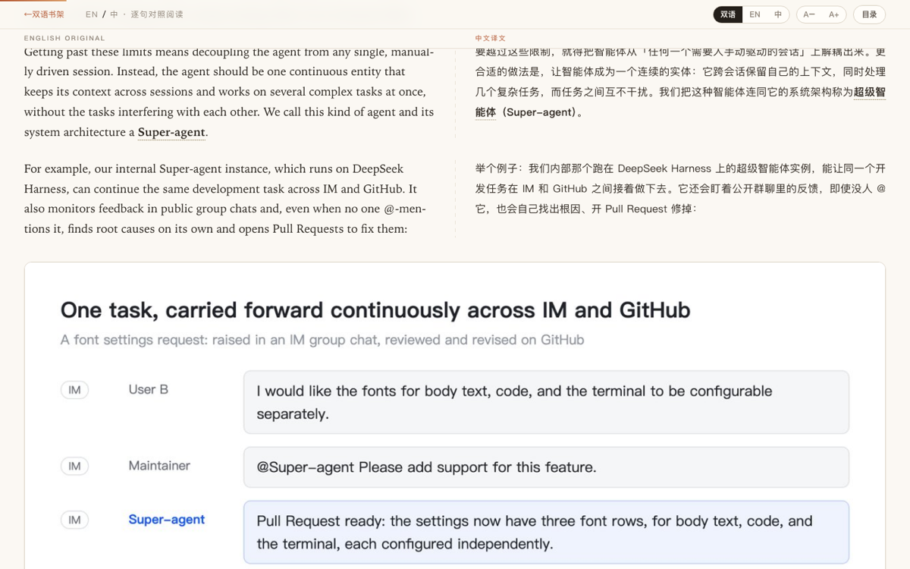
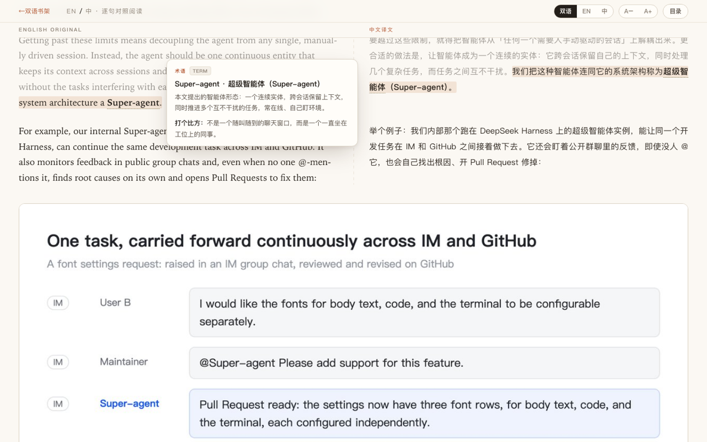
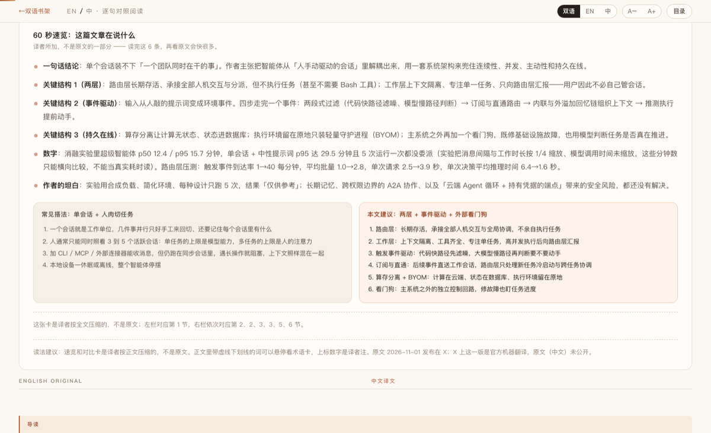
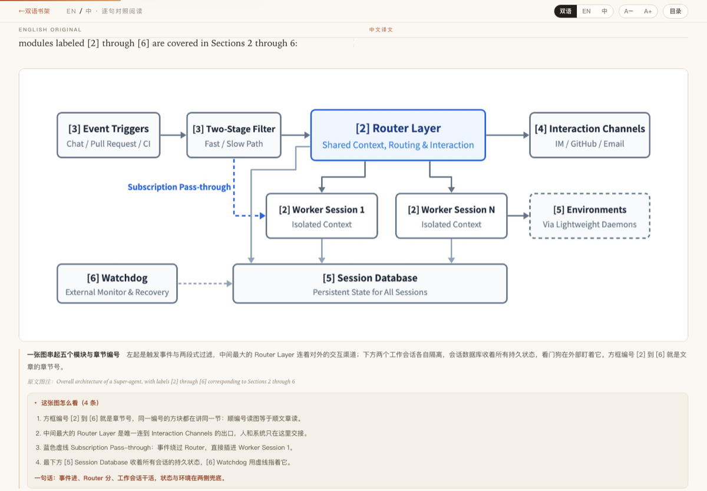
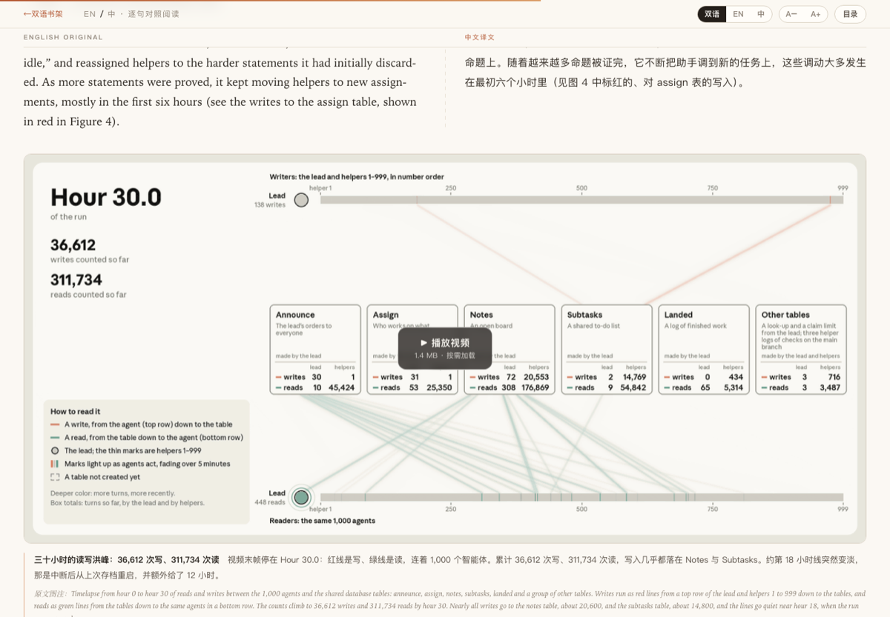
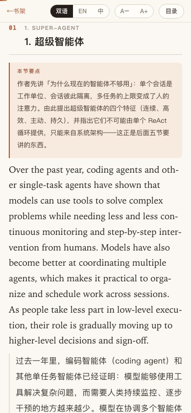

# bilingual-annotated-reader

> 把英文长文做成「左原文、右译文、逐句联动」的可读网页，产出是**单个可离线双击打开的 HTML**。
>
> Turn an English long-form article into a sentence-aligned bilingual reading page — one offline HTML file.

---

## 它解决的不是「翻译」，是「读完」

用户说「帮我翻译」时，真正想要的是**一个外行把这篇专业长文读完，并且看懂**。所以这个 skill 交付的是网页，不是译文；质量重心在三处：

1. **逐句对齐** —— 数据里就是句对，不是段对段。读者不会在猜「这句对应哪句」。
2. **原文保真** —— 英文列逐字回查原文；允许的差异只有三种：原文笔误（照录并备案）、补的排版空格、显式备案。
3. **补充层不打断阅读** —— 正文只留极轻的虚线，信息在悬停时出现，完整清单只在文末。

一句自检：**把页面关掉，能不能凭它复述原文的论证链？**

## 成品长什么样

真实成品（不是示意图）：<https://xiuerhuahuazi.github.io/blog-xiuerhuahuazi/readers/>

### 双栏 + 句级联动

悬停任一句，另一侧同一句同步高亮。



### 术语卡

术语只标首次出现；虚线下划线悬停（或键盘聚焦）弹出卡片，含中英名、定义、一个比方。



### 60 秒速览 + 左右对比卡

先给结论，再进正文；速览和对比卡会明确标注「译者所加，不是原文」。



### 图注解读

每张图配双语图注 + 「这张图怎么看」的逐条读法 + 一句话 takeaway。



### 视频点播

默认显示末帧海报，点击才加载；单文件版内嵌 Blob，云端版走外置 media/。



### 手机与阅读模式

窄屏自动改成「英文在上、中文在下」；顶部可切「双语 / EN / 中」、调字号、开目录。



## 能力清单

| 能力 | 说明 |
|---|---|
| 句级对齐 | 英文句与中文句一一绑定，悬停/点击联动 |
| 三种悬停卡 | 术语卡、译者注、延伸阅读卡 |
| 图注解读 | 双语图注 + 怎么看 + 静帧/动图切换 |
| 速览与对比 | 60 秒速览、左右对比卡、读法建议 |
| 外链三层渐进 | 正文极轻标记 → 悬停卡说明 → 文末阅读地图 |
| 视频 | 末帧海报 + 点击播放；支持内嵌 base64、外置 media/ |
| 题图 | 标题下方的题图与题注，不计入配图数 |
| 两种交付 | 单文件 HTML / 云端版（HTML + 外置媒体，支持 Range） |
| 阅读体验 | 双语/EN/中切换、字号调节、目录、阅读进度、打印样式 |
| 质量闸门 | 一条命令跑构建 + 保真 + 标签 + 冒烟，写 QA 证据 |

## 安装

```bash
git clone https://github.com/xiuerhuahuazi/skills.git
cd skills
./install.sh bilingual-annotated-reader          # 默认装到 ~/.agents/skills/
```

也可以手动复制：

```bash
cp -R skills/bilingual-annotated-reader ~/.agents/skills/
# Claude Code 用户：cp -R skills/bilingual-annotated-reader ~/.claude/skills/
```

**依赖**：Node.js 18+。截图与冒烟测试需要本机有 Chrome / Chromium（macOS、Linux、Windows 的常见路径会自动探测；没有也能构建，只是 gate 会记「部分未验证」）。

## 三分钟上手

```bash
# 1. 建骨架（会生成 build.mjs、src/、tools/、data/skill.json）
node tools/scaffold.mjs ~/readers/my-article --article ./article.md

# 2. 填数据：meta.json（标题/速览/译注）、part-*.json（逐句对照）、
#    links.json、glossary.json、figures.json —— 契约见 references/02-data-contract.md
cd ~/readers/my-article

# 3. 构建 + 自检 + 截图
node build.mjs
node tools/gate.mjs --shots

# 4. 人工看完截图后登记确认
node tools/gate.mjs --confirm "看完三张截图，可以交"

# 5. 图片瘦身（转 WebP + 按显示尺寸收敛，改的是 config/meta 的引用）
python3 tools/slim-media.py --dry        # 先看表格；去掉 --dry 才落盘
python3 tools/slim-media.py --backup .bak

# 6. 出两种交付形态（单文件 + cloud/）
node tools/publish.mjs
```

已有项目升级只需同步 `tools/`：

```bash
node tools/scaffold.mjs --refresh ~/readers/my-article     # src/ 默认只报告差异
```

## 数据契约

项目里只有 `data/` 是「这篇文章的解释」，`src/` 与 `tools/` 是模板快照（改 skill 再刷新，别在项目里手改）。

| 文件 | 放什么 |
|---|---|
| `data/meta.json` | 标题、速览、对比卡、译注、笔误备案、题图 |
| `data/part-*.json` | 逐句对照（`[英文, 中文]`），按章节拆文件 |
| `data/links.json` | 延伸阅读卡 |
| `data/glossary.json` | 术语卡 |
| `data/figures.json` | 配图、图注、怎么看 |
| `data/article.md` | 原文快照（保真回查的基准） |
| `data/survey.json` | 抓取勘察：图/表/视频/代码/外链计数 |

## 质量门禁

`node tools/gate.mjs` 会写出 `QA.md` / `QA.json`，四态分别是：

| 状态 | 判据 |
|---|---|
| 自动验证 | 构建 + 内容保真 + 标签 + 冒烟全绿 |
| AI 评估 | `QA-review.md` 的「严重」条目为 0 |
| 人工确认 | `gate.mjs --confirm "…"` 登记，并绑定当时的文件哈希 |
| 尚未验证 | 这次没跑的项，逐条列出 |

**没有 `QA.md` 就不算验证通过。** 内容一改，人工确认即失效。

## 目录结构

```
SKILL.md                 技能说明（agent 读这个）
README.md                本文件（人读这个）
CHANGELOG.md             版本与改动
references/              抓取、数据契约、页面规范、QA、踩坑、反馈、案例、媒体
templates/               页面模板、样式、构建脚本
tools/                   脚手架、构建闸门、冒烟、截图、抓取勘察、发布、图片瘦身
docs/img/                README 里的示例图
```

## 三条不可妥协的线

1. **英文列逐字保真**，不顺手润色限定词（`often` 不是 `always`）。
2. **层与层不许打架**：正文不塞摘要，悬停卡不遮正文，清单只在文末。
3. **每句译文都能指回原文那一句**：拒绝段落级对齐。

## 已知坑

`references/05-pitfalls.md` 记了实际踩过的坑：headless 最小窗口造成的「移动端溢出」假象、CSS 过渡在 virtual-time 下不推进、负 margin 切片超过 ~20000px 白屏、`String.replace` 的 `$` 语义、defuddle 丢图吞表、Chrome 路径写死导致假失败……

视频与云端相关的坑单列在 `references/08-media-cloud.md`：Safari 对 data URI 视频不稳（要用 Blob）、base64 与 HTTP 缓存互斥、Range/206、海报懒加载。
图片体积也在这份文档的 §0：单图 ≤ 260 KB、单页 ≤ 1 MB，超了就跑 `slim-media.py`；PNG 只重编码不降尺寸会变大，动图别转 animated WebP。

## 版本与反馈

当前 **v2.3.0**（2026-11-19）。改动记录见 [CHANGELOG.md](CHANGELOG.md)；收到反馈怎么进下一版见 [references/06-feedback.md](references/06-feedback.md)。

## 示例与版权

- 阅读页示例：<https://xiuerhuahuazi.github.io/blog-xiuerhuahuazi/readers/>
- 文中截图取自上述精读成品页；原文与图片版权属于原文章与原作者（Anthropic、claude.dev、X 作者等），这里仅作工具效果展示。
- 本 skill 的代码与模板以 MIT 许可发布，见仓库根目录 [LICENSE](../../LICENSE)。
